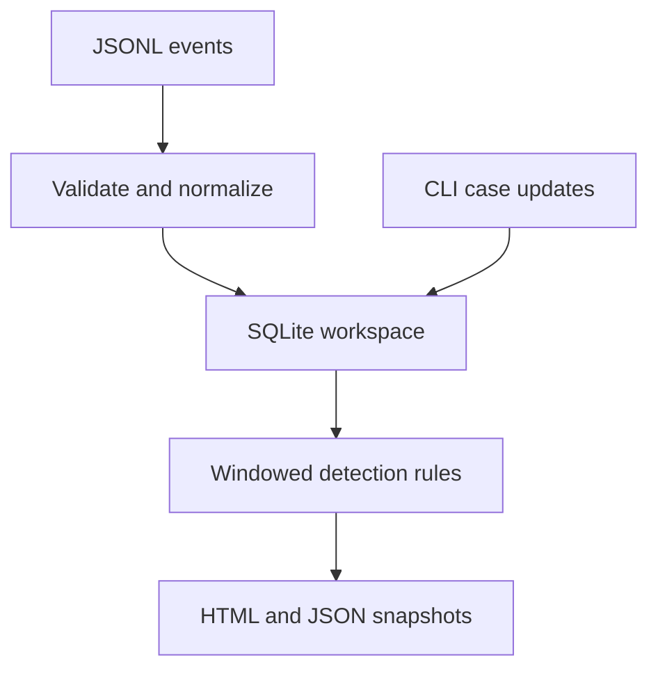

# TraceGuard

**Offline SOC log triage and investigation, with evidence you can inspect.**

TraceGuard turns normalized authentication and network events into explainable security alerts and a portable investigation dashboard. Python's standard library handles ingestion, deterministic detection, SQLite case tracking, and self-contained HTML/JSON reporting. No API key, external service, or paid dependency is required.

Built by **Dr. Muhammad Asif**. This project complements SentinelIDS (machine-learning intrusion classification) and VulnPilot (vulnerability prioritization) with a practical detection-engineering and analyst workflow.

## Quick start

Requires **Python 3.11+** and a modern browser. On Windows, use `py`; on Linux/macOS, use `python3` in the commands below.

```powershell
cd TraceGuard
py traceguard.py demo
Start-Process exports/report.html
```

The demonstration creates 68 synthetic events using documentation IP addresses and produces four alerts. Open `exports/report.html` directly in your browser. The dashboard supports search, severity and status filters, evidence review, hourly event volume, rule coverage, and printing to PDF.

The browser displays a snapshot. Update case status through the CLI, regenerate the report, and refresh the page:

```powershell
py traceguard.py cases
py traceguard.py case ALERT_ID --status Investigating --notes "Checking the identity provider logs"
py traceguard.py report
```

Replace `ALERT_ID` with an ID from `cases`. Quoted statuses are `"New"`, `"Investigating"`, `"Closed - benign"`, and `"Closed - confirmed"`.

## Analyze your own events

Use a separate workspace for each investigation. Global `--db` goes **before** the command:

```powershell
py traceguard.py --db data/investigation.db analyze samples/events.jsonl --output exports/investigation
py traceguard.py --db data/investigation.db cases
py traceguard.py --db data/investigation.db case ALERT_ID --status Investigating --notes "Analyst notes" --output exports/investigation
py traceguard.py --db data/investigation.db report --output exports/investigation
```

`demo` requires an empty workspace so demonstration data cannot silently mix with an existing investigation. `analyze` appends validated events and reruns detection across the complete workspace. Validation failure rejects the import before insertion. Reimporting identical normalized events is idempotent.

## Event contract

Input is UTF-8 JSON Lines: one object per nonblank line. Convert vendor-specific exports to this schema before importing. TraceGuard does not parse arbitrary Windows Event Logs, syslog, or packet captures.

| Field | Required | Meaning |
| --- | --- | --- |
| `timestamp` | Yes | ISO 8601 with timezone, e.g. `2026-11-17T09:00:00Z`; normalized to UTC |
| `event_type` | Yes | `auth_failure`, `auth_success`, or `network_connection` |
| `host` | Yes | Destination host or service; maximum 200 characters |
| `src_ip` | Yes | Valid IPv4 or IPv6 address |
| `user` | Authentication | Account name; maximum 200 characters |
| `dst_port` | Network | Integer from 0 through 65535 |

```json
{"timestamp":"2026-11-17T09:00:00Z","event_type":"auth_failure","host":"identity-01","src_ip":"192.0.2.10","user":"alice"}
{"timestamp":"2026-11-17T09:00:10Z","event_type":"auth_success","host":"identity-01","src_ip":"192.0.2.10","user":"alice"}
{"timestamp":"2026-11-17T09:01:00Z","event_type":"network_connection","host":"app-01","src_ip":"198.51.100.20","dst_port":443}
```

Unrecognized fields are discarded. Control characters in names, missing fields, invalid addresses, naive timestamps, and invalid port values are rejected. Limits: 20 MB per input and 50,000 unique events per workspace. These are prototype bounds, not a throughput guarantee.

## Detection coverage

| ID | Detection | Trigger | Severity | ATT&CK reference |
| --- | --- | --- | --- | --- |
| TG-001 | Repeated authentication failures | 10 failures / 5 minutes for one source, host, and user | High | T1110 |
| TG-002 | Possible password spraying | 10 distinct users with failures / 10 minutes from one source | High | T1110.003 |
| TG-003 | Success after repeated failures | Success following at least 5 failures / 10 minutes for one source, host, and user | Critical | T1078 |
| TG-004 | Possible port probing | 20 distinct destination ports / 5 minutes for one source and destination host | Medium | T1046 |

All thresholds use event time and inclusive window boundaries. Alerts are emitted at the first qualifying event, with a per-rule/group cooldown equal to the rule window. TG-003 clears its failure window after a success. Events are sorted by normalized timestamp and stable event ID; identical timestamps have a deterministic ordering that does not establish real-world sequence.

Password spraying is a hypothesis: these logs cannot establish that the same password was tried. A successful login after failures is an investigation lead, not proof of compromise. Port-probing alerts can reflect authorized scanners. NAT, shared gateways, stale credentials, monitoring, and service accounts can all generate false positives. Investigate source ownership, MFA, user confirmation, and surrounding telemetry before reaching a conclusion.

ATT&CK IDs describe related behavior; they do not validate a detection or establish malicious intent. References: [Brute Force](https://attack.mitre.org/techniques/T1110/), [Password Spraying](https://attack.mitre.org/techniques/T1110/003/), [Valid Accounts](https://attack.mitre.org/techniques/T1078/), [Network Service Discovery](https://attack.mitre.org/techniques/T1046/), and [OWASP logging guidance](https://cheatsheetseries.owasp.org/cheatsheets/Logging_Cheat_Sheet.html).

## Evidence and case behavior

Each alert records its rule version, trigger time, grouping scope, observed count, and event IDs. The detail view shows at most the last 100 evidence events and reports the full evidence count. The trigger host/user are contextual fields; check the grouping scope for multi-account alerts.

Normalized event contents are SHA-256 hashed for deduplication. Identical events collapse even if the source system intended them as separate records. There is no vendor event-ID field in this version. Alert IDs depend on the rule, group, and triggering event. A late-arriving import can change the trigger event, replace an alert ID, and leave old case notes associated with a historical ID. Review case continuity when importing older data; notes are not automatically reassigned.

SQLite stores `New`, `Investigating`, and closed statuses, analyst notes, and a local activity history. History is an operational convenience, not a tamper-evident audit log. Reports include the latest 100 history entries. Database records remain local until you copy or share them.

## Architecture



| Path | Purpose |
| --- | --- |
| `traceguard.py` | Parser, detector, persistence, report generator, CLI |
| `web/report.html` | Self-contained report template |
| `tests/test_traceguard.py` | Detection and workflow regression tests |
| `samples/events.jsonl` | Synthetic demonstration input |
| `docs/THREAT_MODEL.md` | Trust boundaries, controls, limitations |
| `.github/workflows/ci.yml` | Automated Python tests |
| `publish.ps1` | Validate and publish through authenticated GitHub CLI |

## Verification

```powershell
py -m unittest discover -s tests -v
py -m compileall -q traceguard.py tests
```

Tests cover rule thresholds, distinct-account and distinct-port conditions, ordering, deduplication, invalid input, persistent case updates, and HTML script-boundary escaping. These are functional checks against synthetic data, not an independent security assessment or accuracy benchmark. There are no measured production recall or false-positive claims.

## Data handling and limitations

The application makes no network requests and takes no response action. HTML reports embed normalized events and analyst notes. Treat HTML, JSON, SQLite, and exported PDFs as sensitive investigation material. The template has a restrictive content security policy; dynamic content is escaped and report JSON escapes script delimiters. Inline scripts and styles are required by the portable report format. This does not replace secure handling of files on the host.

There is no authentication, multi-user concurrency model, encryption at rest, log collector, live monitoring, case assignment, SIEM integration, or built-in retention policy. Protect the workstation and database with operating-system access controls and disk encryption. Use only logs you are authorized to analyze. Keep secrets and personal information out of public repositories. Generated workspaces and reports are excluded by `.gitignore`.

## Publish on GitHub

With Git and [GitHub CLI](https://cli.github.com/) installed, authenticate using `gh auth login`, then run:

```powershell
.\publish.ps1 -Owner asif3252
```

The script runs tests, initializes this folder as its own Git repository, stages an explicit source-file allowlist, and creates the public `TraceGuard` repository. It stops if an `origin` remote is already configured. Read the script before running it. No credentials or generated investigation data are included.

## Roadmap

- Vendor adapters with stable source event IDs and explicit provenance.
- Configurable rules with validation and versioned fixtures.
- Case continuity when late-arriving events change trigger IDs.
- Labeled evaluation datasets and measured false-positive analysis.

See [CONTRIBUTING.md](CONTRIBUTING.md), [SECURITY.md](SECURITY.md), and the [MIT license](LICENSE).
